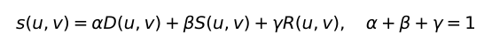
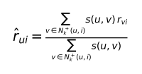

# SRCF-Repro

**Reproduction of SR-CF for cold-start recommendation** · **面向冷启动推荐的 SR-CF 算法复现**

 [Releases](https://github.com/ZJY-HSBL/SRCF-Repro/releases) · [Replication protocol / 复现规范](docs/REPLICATION.md)

## 研究背景 · Research overview

本项目复现乔雨（2018）硕士论文《面向冷启动问题的推荐算法研究》第四章的 **SR-CF**（融合用户相似度与评分信息的协同过滤算法）。它结合用户基本属性 `D`、种子项目评分 `S` 和历史评分 `R`，以增强新用户的邻居发现能力。**这是论文复现工程，不声称算法原创。**

This repository implements the chapter-4 **Similarity and Rating-based Collaborative Filtering (SR-CF)** approach in Qiao Yu's 2018 master's thesis. It combines demographic similarity (`D`), seed-item similarity (`S`), and historical-rating similarity (`R`) for sparse / new-user recommendation. **The SR-CF method originates in the cited thesis; this repo does not claim its invention.**


## 核心公式 · Method

论文第 34 页公式（4.8） / Eq. (4.8), printed p. 34:

```math
\operatorname{sim}(u,v)=\alpha D(u,v)+\beta S(u,v)+\gamma R(u,v),
\qquad \alpha+\beta+\gamma=1.
```



下列为**本项目单独标记的归一化修正版**，不是论文的原公式（4.4）。The normalized positive-neighbor predictor is an explicitly corrected implementation, **not** the paper's literal Eq. (4.4):

```math
\widehat{r}_{ui}^{\mathrm{norm}}=\frac{\sum_{v\in N_k^{+}(u,i)} s(u,v)r_{vi}}{\sum_{v\in N_k^{+}(u,i)} s(u,v)}
```



论文报告的融合权重 / Reported weights: **(α, β, γ) = (0.2, 0.3, 0.5)**. Demographics use age buckets, gender, and occupation; seed and history correlations are calculated on co-rated items.

**Important: Equation (4.4) is an unnormalized sum.** `--prediction paper` preserves it. The default `--prediction normalized` deliberately uses a normalized positive-neighbor mean and train-only fallback. Both are implemented and must be **reported separately**.

## 数据与实测 · Data & measured results

| Source / 来源 | Purpose / 用途 | Status / 状态 |
|---|---|---|
| Thesis Table 4.2 | Published coverage comparison / 原论文覆盖率比较 | **Reported only / 论文报告** |
| Synthetic: 42 users, 60 items, 1,092 ratings | Functionality smoke benchmark / 功能验证 | **Actually executed / 已运行** |
| MovieLens-100K | Genuine replication evaluation / 真实数据复现 | **Real experiment complete / 已完成真实实验** |


**原论文报告**：邻居数 `k=100` 时，SR-CF、DR-CF 和 UB-CF 的覆盖率分别是 **27.3%、23.8%、21.3%**；这张图不是本项目运行所得。 / **Paper-reported only**: coverage at `k=100` is 27.3%, 23.8%, and 21.3%, respectively; not independently reproduced here.


合成冷启动实验采用完全留出的目标用户，固定每个目标用户的 5 条测试评分，然后分别开放 0/1/3/5/10 条历史行为。0 条时，SR-CF 与 DR-CF 的 MAE 都是 **0.7292**；3 条时 DR-CF 为 **0.6583**，SR-CF 为 **0.8805**。这意味着固定权重可能在极稀疏条件下表现不稳定，必须用真实数据验证。 / A user-disjoint synthetic cold-start study holds out five ratings per user and exposes 0/1/3/5/10 history ratings. At zero observations, SR-CF and DR-CF have identical MAE **0.7292**; at three, DR-CF achieves **0.6583** versus SR-CF **0.8805**. This motivates, but does not establish, an adaptive-weight hypothesis.

**真实运行的合成数据**，种子 2026，32 个测试用户，160 条测试评分，各模型均使用归一化预测器 / **Measured on synthetic data** with seed 2026, 32 evaluated users, 160 test ratings, normalized predictor:

| k | UB-CF MAE ↓ | DR-CF MAE ↓ | SR-CF MAE ↓ |
|---:|---:|---:|---:|
| 5 | 0.7525 | 0.8256 | **0.7505** |
| 10 | 0.6748 | **0.6426** | 0.6500 |
| 20 | 0.7068 | **0.7066** | 0.7073 |

在合成实验中，SR-CF 并非全面领先。例如 k=10 时 DR-CF 更好，且模型之间的差异较小。后续重点是 **在独立真实数据上检验权重与种子集的有效性**，不能根据上述结果宣称论文性能已被复现。 / SR-CF does not dominate in this synthetic experiment (e.g. DR-CF has lower MAE at k=10). No published-paper performance claim is inferred from this toy result.

Full raw rows: [`benchmark.csv`](artifacts/demo/benchmark.csv) · [`benchmark.json`](artifacts/demo/benchmark.json). Coverage data transcribed verbatim: [`paper_coverage.csv`](artifacts/paper_coverage.csv).

## MovieLens-100K 真正实测 · Real-data evaluation

真实数据已在 GitHub Actions 环境中运行，含常规留出集和固定测试项目的 0/1/3/5/10 条历史行为冷启动实验。详见 [真实数据实验报告 / real-data results](docs/REAL_RESULTS.md)。**Independent real-data results, not exact numerical replication of the thesis.**


## 多随机批次冷启动 · Multi-batch cold-start evaluation

<!-- STUDY_RESULTS_START -->
### 多批次冷启动实验 · Repeated cold-start study

**SYNTHETIC**, 16 independent target users, fixed holdouts, no test-set tuning. 结果全部保留，既包括支持假设也包括反例。

| Visible | ub | dr | sr | sr_no_seed | sr_no_history | sr_schedule |
|---:|---:|---:|---:|---:|---:|---:|
| 0 | 1.1087 | 0.6762 | 0.6762 | 0.6762 | 0.6762 | 0.6762 |
| 1 | 1.1099 | 0.6648 | 0.6648 | 0.6648 | 0.6648 | 0.6648 |
| 3 | 1.0505 | 0.6699 | 0.7281 | 0.7285 | 0.6710 | 0.6789 |
| 5 | 1.0265 | 0.6764 | 0.8417 | 0.8398 | 0.6767 | 0.6688 |
| 10 | 0.7818 | 0.6570 | 0.7759 | 0.7482 | 0.7411 | 0.7759 |


[完整实验报告、配对 Bootstrap 置信区间 / full study and CIs](docs/REPEATED_RESULTS.md)

<!-- STUDY_RESULTS_END -->

## 安装与复现 · Installation & reproduction

Python **3.10+**:

```bash
python -m pip install -e ".[plot,test]"
pytest
# Fully local, deterministic synthetic smoke benchmark / 本地合成数据
python -m srcf_repro.experiment --out artifacts/local/demo --seed 2026
python -m srcf_repro.experiment --cold --max-users 15 --out artifacts/local/cold --seed 2026
```

真实数据 **MovieLens-100K**：从 [GroupLens 官方下载页](https://grouplens.org/datasets/movielens/100k/) 获取并解压 `ml-100k`，确保包含 `u.data` 和 `u.user`。然后运行 / For the actual MovieLens-100K benchmark, obtain the official archive and run:

```bash
python -m srcf_repro.experiment --data-dir ./ml-100k --max-users 200 --out artifacts/local/ml100k
python -m srcf_repro.experiment --data-dir ./ml-100k --max-users 200 --prediction paper --out artifacts/local/ml100k-paper
```

**论文存在数据集标识冲突**：第四章写的是 `ml-1m`，但其用户数 **943**、电影数 **1682**、评分数 **100000** 对应 **MovieLens-100K**。具体处理及其他未公开实验细节见 [复现规范 / replication notes](docs/REPLICATION.md)。/ The thesis calls its data “ml-1m” while providing the MovieLens-100K counts. We do **not** silently equate the two datasets.

## 工程与路线图 · Engineering & roadmap

- `src/srcf_repro/model.py` — three modes, mixed similarities, literal/normalized score prediction.
- `src/srcf_repro/data.py` — train/test split, popularity-based seed selection, official `u.data` / `u.user` parser.
- `src/srcf_repro/experiment.py` — deterministic MAE/RMSE/coverage benchmarks and SVG export.
- `src/srcf_repro/studies.py` — pre-registered ablations, user-disjoint repeated cold-start studies, subject-level paired bootstrap; automatically generates data/report/SVG.
- `tests/` — mathematical edge cases, reproducibility, train/test isolation, and smoke results.
- `.github/workflows/ci-release.yml` — quality gate and release-on-version-commit workflow.

Next / 下一步：本版本执行严格用户隔离的多批次重复实验、固定权重消融及探索性分段权重比较。后续将在独立验证集上调参，并在全新数据集上确认，而不能凭单轮实验宣称创新有效。 / Multiple user-disjoint batches and paired bootstrap intervals precede any validation-only tuning and external confirmation.

## 引用 · Citation

乔雨. **面向冷启动问题的推荐算法研究**. 南京邮电大学工学硕士学位论文, 2018 年 2 月, 第四章, pp. 29–37. / Qiao Yu, *Research on Recommendation Algorithms Against Cold-Start Problem*, Nanjing University of Posts and Telecommunications, Feb. 2018, Chapter 4.

License for **this implementation**: MIT. Original thesis copyright remains with its author.
