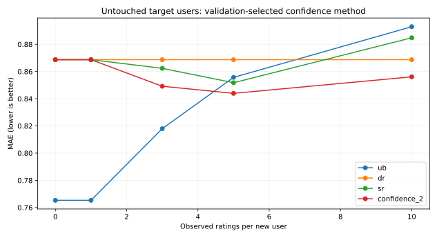

# Validation-frozen confidence study / 可信度收缩验证实验

**MOVIELENS-100K; measured experiment, not the source thesis's numerical replication.**

## Precommitted question / 科研假设

Does support-dependent shrinkage of the seed-rating and historical-rating
similarity terms improve prediction under 3/5/10 observed ratings? The
method is an exploratory modification proposed in this repo, **not** SR-CF
as defined by Qiao Yu (2018).

Users from earlier exploratory studies (n=144) are **excluded**
from reference, validation, and test. New users are assigned once with RNG
seed 314159; reference 719, validation 32
and untouched test 48; the same five holdout ratings
per target remain hidden at each interaction budget. Each model's neighbors
are exclusively *reference users*: new validation/test users cannot act as
one another's neighbors.

## Validation-only hyperparameter selection

Candidate support shrinks: `λ=2`, `λ=10`, `λ=30`; seed item count **40**,
neighbor count **10**, SR-CF original weights `(0.2,0.3,0.5)`. Candidate
selection uses only equal-weight per-user validation MAE averaged over
budgets `(3, 5, 10)`; tie-break lexicographic.

{
  "selected": "confidence_2",
  "validation_mean_mae": {
    "confidence_2": 0.91982313,
    "confidence_10": 0.92437081,
    "confidence_30": 0.92097513
  },
  "criterion": "equal-weight average of per-user MAE over budgets 3,5,10"
}

## Validation scores (diagnostic only)

| Observed | ub | dr | sr | confidence_2 |
|---:|---:|---:|---:|---:|
| 0 | 0.8194 | 0.9335 | 0.9335 | 0.9335 |
| 1 | 0.8194 | 0.9335 | 0.9335 | 0.9335 |
| 3 | 0.9338 | 0.9335 | 0.8802 | 0.9121 |
| 5 | 0.9111 | 0.9335 | 0.8778 | 0.9494 |
| 10 | 0.9027 | 0.9335 | 0.9108 | 0.8980 |

## Untouched-user test results / 独立目标用户测试

| Observed | ub | dr | sr | confidence_2 |
|---:|---:|---:|---:|---:|
| 0 | 0.7653 | 0.8687 | 0.8687 | 0.8687 |
| 1 | 0.7653 | 0.8687 | 0.8687 | 0.8687 |
| 3 | 0.8180 | 0.8687 | 0.8623 | 0.8492 |
| 5 | 0.8557 | 0.8687 | 0.8518 | 0.8440 |
| 10 | 0.8929 | 0.8687 | 0.8848 | 0.8561 |

## Paired test-user comparisons

Differences = A − B; negative favors A. 3,000-resample user-cluster percentile
bootstrap; all three observation budgets per user resampled together.
Intervals are **exploratory**, unadjusted for multiple comparisons, and
conditional on MovieLens-100K; this is not cross-dataset confirmation.

| Test comparison | ΔMAE | Exploratory 95% CI | Paired users |
|---|---:|---:|---:|
| confidence_2 - sr | -0.0166 | [-0.0624, +0.0301] | 48 |
| confidence_2 - dr | -0.0190 | [-0.0754, +0.0344] | 48 |
| confidence_2 - ub | -0.0058 | [-0.0695, +0.0521] | 48 |
| confidence_10 - confidence_10_no_seed | +0.0089 | [-0.0034, +0.0213] | 48 |

## Limitations / 局限性

- Earlier cohorts are excluded, but reference data and new-user holdouts come from
  the same MovieLens-100K dataset; this does not demonstrate external generalization.
- This is a user-level fixed-k rating-error experiment; it does not directly
  establish ranking quality (NDCG@K), coverage or computational scalability.
- The old SR-CF Pearson term includes seed-rated items again as history; seed
  and history are correlated and not independent evidence.
- The current confidence rule also rescales effective fusion weights; ablate
  confidence shrinkage versus renormalization in future experiments.
- If CIs include zero, report no confirmed gain. Negative results remain visible.

Raw audit / 原始数据：`validation_per_user.csv`, `test_per_user.csv`,
`summary.csv`, `paired_intervals.csv`, `protocol.json`.
