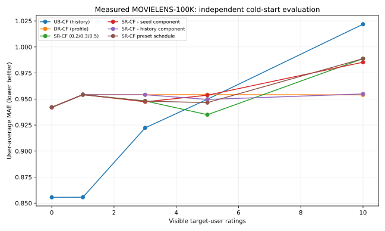

# Repeated cold-start ablation / 多批次冷启动消融实验

**Actually measured: MOVIELENS-100K.** The full source dataset is not checked into the repository.

**Protocol / 方法：** 4 non-overlapping target-user batches, 24 users per batch (96 unique users); fixed five-rating test holdout per user; 0/1/3/5/10 *nested* visible interactions; all target users excluded from the reference population across all batches. Global study seed **2026**, neighborhoods **k=10**, train-only top-12 popular seed items, corrected normalized predictions. Mean MAE is **user-averaged**, so users with more usable test ratings do not receive more weight. No model was chosen using test ratings.

本实验严格隔离参考用户与目标用户，所有批次的目标用户互不重叠；每位目标用户固定五条测试评分，仅逐步公开训练交互记录。固定权重和预设分段权重均属于**探索性假设**，并未在测试集上调参。

## MAE vs observation budget / MAE 与历史交互量

| Visible | ub | dr | sr | sr_no_seed | sr_no_history | sr_schedule |
|---:|---:|---:|---:|---:|---:|---:|
| 0 | 0.8556 | 0.9420 | 0.9420 | 0.9420 | 0.9420 | 0.9420 |
| 1 | 0.8557 | 0.9542 | 0.9542 | 0.9542 | 0.9542 | 0.9542 |
| 3 | 0.9223 | 0.9541 | 0.9481 | 0.9473 | 0.9541 | 0.9479 |
| 5 | 0.9498 | 0.9542 | 0.9349 | 0.9537 | 0.9496 | 0.9466 |
| 10 | 1.0219 | 0.9540 | 0.9888 | 0.9854 | 0.9549 | 0.9888 |

## Paired comparisons / 配对比较

Per-user paired MAE difference (A − B, negative favors A). Nonparametric subject-level percentile bootstrap with 2,000 resamples, seed 9301. CIs are exploratory and **not** multiplicity adjusted.

| Observed | A − B | Mean difference | 95% bootstrap CI | Wins A / users |
|---:|---|---:|---:|---:|
| 3 | sr − ub | +0.0258 | [-0.0168, +0.0713] | 48 / 96 |
| 10 | sr − ub | -0.0331 | [-0.1088, +0.0459] | 44 / 96 |
| 3 | sr − dr | -0.0060 | [-0.0714, +0.0641] | 43 / 96 |
| 10 | sr − dr | +0.0348 | [-0.0421, +0.1138] | 48 / 96 |
| 3 | sr_schedule − sr | -0.0002 | [-0.0316, +0.0304] | 41 / 96 |
| 10 | sr_schedule − sr | +0.0000 | [+0.0000, +0.0000] | 0 / 96 |

## Caveats and next experiment / 解释与下一步

- This is **not** exact replication of the source thesis (seed selection and evaluation split were not fully specified there).
- Predeclared `sr_schedule` weights use (1,0,0) at 0 ratings; (.7,.2,.1) at 1; (.5,.2,.3) at 3/5; and (.2,.3,.5) at 10. These have not been fitted to a validation set; if they improve, that is only an exploratory finding.
- Holdouts missing from the reference item's vocabulary are excluded by the predictor, and `n_test` records the number retained. This is a conditional, not full-catalog new-item evaluation.
- Bootstrap intervals condition on this dataset and protocol; use a *separate* held-out dataset and randomized users for confirmatory analysis.
- Next: investigate overlapping seed ratings, profile weights, negative-neighbor handling, and nested cross-validation (validation-only model selection), then test on unseen datasets.

Raw audit / 原始记录：[per-user metrics](../artifacts/real/repeated/per_user.csv) · [summary](../artifacts/real/repeated/summary.csv) · [pairwise bootstrap](../artifacts/real/repeated/paired_bootstrap.csv) · [protocol](../artifacts/real/repeated/protocol.json).
